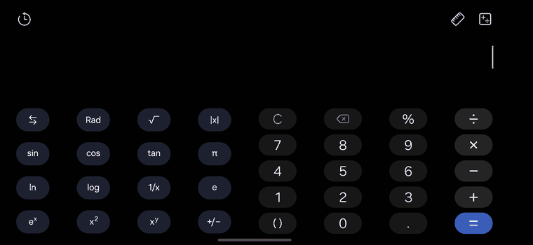

# phone-ctl

A tiny CLI for driving a **real Android phone over ADB** — screenshots, taps, swipes, text — that
actually works on **multi-display devices** (Samsung DeX, external monitors, foldables).

Most adb automation snippets break the moment you plug the phone into a monitor. This one doesn't.

```bash
phone-ctl capture                 # screenshot the phone
phone-ctl tap 540 1200            # tap using coordinates from that screenshot
phone-ctl dex capture             # screenshot the DeX monitor instead
phone-ctl dex tap 2500 1500       # tap on the monitor
```



*Driving a landscape calculator through `phone-ctl tap` — every tap is a plain ADB event.*

[中文说明](README.zh-CN.md)

---

## The problem

If you've ever tried to script an Android phone with `adb shell input` and `screencap`, you've
probably hit all four of these:

| Symptom | Real cause |
|---|---|
| Screenshot is a 15 KB pure-black image | The screen was off. `screencap` returns black, not an error. |
| `screencap -d 0` → `Display Id '0' is not valid` | `-d` wants a **SurfaceFlinger** id (huge number), not the logical display id. |
| `input tap` does nothing on the phone screen | Input defaults to the **focused display**. With DeX attached, that's the monitor. |
| `uiautomator dump` returns another app's UI | It dumps the **currently focused window**, not "the phone". `--display 0` is silently ignored. |
| Taps land on the wrong key after rotation | Screenshot space rotates with the screen (2340×1080), but naive code scales by `wm size` (1080×2340). |

`phone-ctl` handles all four.

## Install

```bash
git clone https://github.com/<you>/phone-ctl.git
cd phone-ctl
./install.sh            # copies to /usr/local/bin (or ~/.local/bin)
```

Requirements: `adb`, `bash`, `python3`. Nothing else. No root, no app, no accessibility service.

Connect your device first:

```bash
adb connect 192.168.1.23:37105     # wireless debugging
# or just plug in USB
```

## Usage

```
phone-ctl [-d N | dex] <command>

  capture | both                 截图（both = 手机 + DeX 两块都抓）
  tap x y                        点击
  swipe x1 y1 x2 y2 [ms]         滑动
  back | home | recents | enter  返回 / 桌面 / 多任务 / 回车
  wake | unlock | keepon | keepoff
  text S | key K                 输入 / 按键
  sh CMD                         直接在设备上执行 shell
  push 本地 远端 | pull 远端 本地
  size | displays | focus | status
```

Coordinates are given in the **last captured image** for that display and are scaled to physical
pixels automatically.

```bash
phone-ctl capture                 # -> /tmp/screen_agent_d0.png (1080x2340)
phone-ctl tap 600 1500            # same coordinate space as that image
```

## How it handles the four gotchas

**1. Two id systems.**
`screencap -d` needs the SurfaceFlinger display id; `input -d` needs the logical one. `phone-ctl`
parses `dumpsys display`, pairs them by display name, and caches the mapping for 5 minutes:

```bash
phone-ctl displays
# 0 4630946970390616451 内置屏幕
# 6 4633127789891506949 LU28R55
```

The logical id of an external display **changes after every reboot** (8 → 6 in my case), so `dex`
resolves it dynamically instead of hardcoding.

**2. Input goes to the wrong screen.**
Every injected event is pinned: `adb shell input -d <logical-id> ...`.

**3. Black screenshots.**
If a capture comes back under 40 KB, it's almost certainly a powered-off display. `phone-ctl` wakes
the device and retries once, logging `（检测到息屏，已唤醒并重拍）`.

**4. Rotation changes the coordinate space.**
`screencap` and `input` share the **same rotated space**: landscape screenshot is 2340×1080, and
`input tap 1241 651` means the same 2341×1081 grid. Scaling coordinates by `wm size` (which reports
the natural 1080×2340) sends taps into the gaps between keys. `phone-ctl` uses screenshot
coordinates 1:1.

**5. The `screencap` warning prefix.**
With multiple displays attached, `screencap -p` prepends:

```
[Warning] Multiple displays were found, but no display id was specified! ...
```

…straight into the PNG stream, corrupting the file. `phone-ctl` keeps only the bytes from the PNG
magic onwards.

## Reading UI text

`uiautomator dump` works for simple apps, but:

```bash
phone-ctl focus          # whatever is focused right now
```

…may be the monitor, not the phone. **On multi-display setups, prefer screenshots + OCR** for
anything you need reliably. `phone-ctl capture` is display-explicit; `uiautomator` is not.

## Limitations

- No root. Can't read other apps' private data, can't touch system partitions.
- UI automation is fragile by nature — any app redesign breaks coordinate-based flows.
- `input text` can't type non-ASCII reliably; use an IME that accepts broadcasts
  (e.g. [ADBKeyboard](https://github.com/senzhk/ADBKeyBoard)) for Chinese.
- Tested on Samsung SM-S9210 + DeX. Should work on any multi-display Android, untested elsewhere.

## Why not just use X?

`scrcpy` mirrors a screen; `uiautomator2`/Appium drive apps through instrumentation; `Tasker` runs
on-device. None of them solve "which display am I talking to" when a monitor is attached. That's the
gap this fills — it's a thin layer, not a framework.

## License

MIT
