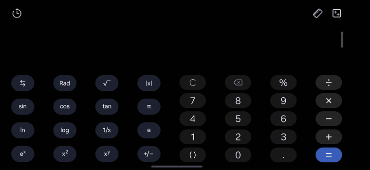

# phone-ctl

用 ADB 控制真机：截图、点击、滑动、输入——**专门解决多显示器（三星 DeX / 外接屏 / 折叠屏）下的各种坑**。

大部分 adb 自动化片段，一插上显示器就失效。这个不会。

```bash
phone-ctl capture        # 抓手机屏
phone-ctl tap 540 1200   # 用这张图的坐标点击
phone-ctl dex capture    # 抓 DeX 显示器
phone-ctl dex tap 2500 1500
```



*横屏计算器，每一次点击都是标准的 ADB 事件。*

## 它解决的五个坑

| 现象 | 真正的原因 |
|---|---|
| 截图是 15KB 的纯黑图 | 屏幕息了。`screencap` 不报错，直接返回黑图 |
| `screencap -d 0` 报 `Display Id '0' is not valid` | `-d` 要的是 **SurfaceFlinger id**（大数字），不是逻辑 id |
| 在手机屏上 `input tap` 没反应 | 输入默认打到**当前焦点所在显示器**，DeX 下就是外接屏 |
| `uiautomator dump` 抓到别的 App | 它抓的是**焦点窗口**，不是"手机"；`--display 0` 会被静默忽略 |
| 旋转后点击全错位 | 截图空间跟着屏幕转（2340×1080），但按 `wm size`（1080×2340）缩放就会点进缝里 |

## 安装

```bash
git clone https://github.com/<you>/phone-ctl.git && cd phone-ctl
./install.sh
```

依赖只有 `adb`、`bash`、`python3`。不需要 root、不需要装 App、不需要无障碍服务。

## 关键细节

**两套 display id**：`screencap -d` 用 SurfaceFlinger id，`input -d` 用逻辑 id。本工具解析
`dumpsys display`，按显示器名字配对并缓存。

**外接屏的逻辑 id 每次重启都会变**（我这里是 8 → 6），所以 `dex` 是动态解析的，不写死。

**旋转不改坐标**：`screencap` 和 `input` 共用同一个"当前旋转方向"的坐标空间，截图坐标可直接 1:1 使用。

**黑图自动重试**：截图小于 40KB 判定为息屏，自动唤醒重拍一次。

**警告前缀**：多显示器时 `screencap -p` 会往 PNG 流里插一行 `[Warning] Multiple displays...`，
文件直接损坏。本工具只保留 PNG magic 之后的数据。

## 限制

- 无 root：读不到别的 App 私有数据，动不了系统分区
- 坐标式自动化的通病：App 一改版就崩
- `input text` 打不了中文，需要 [ADBKeyboard](https://github.com/senzhk/ADBKeyBoard) 这类广播输入法
- 在三星 SM-S9210 + DeX 上验证，其它多显示器设备未测

## 协议

MIT
